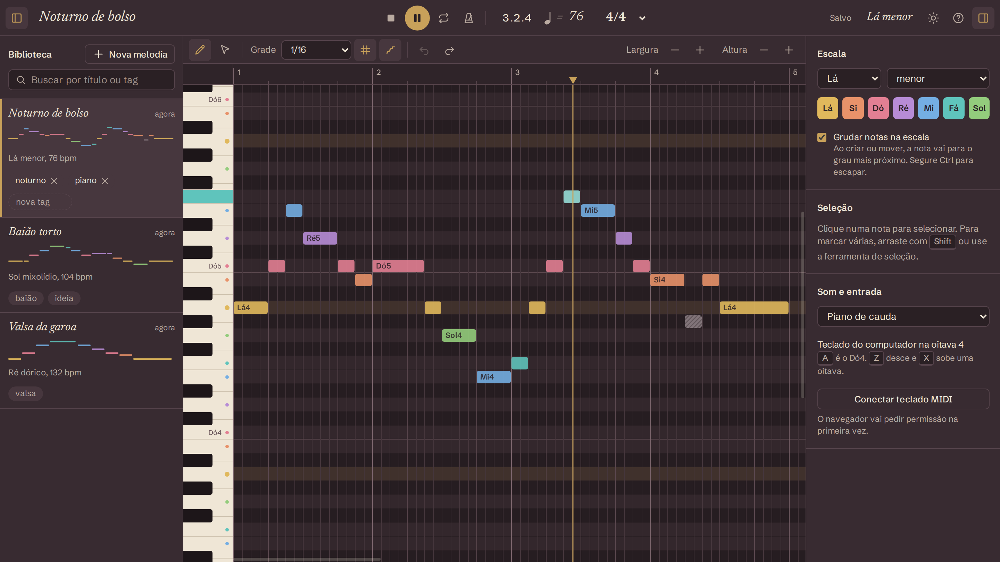
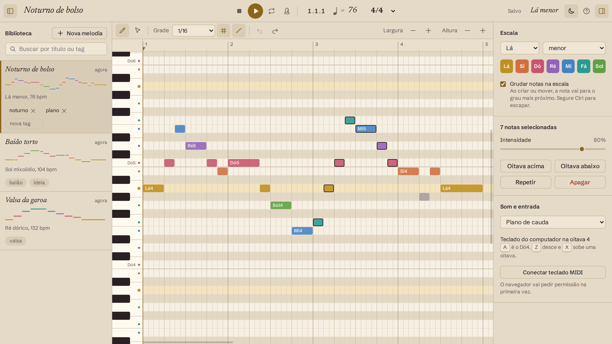
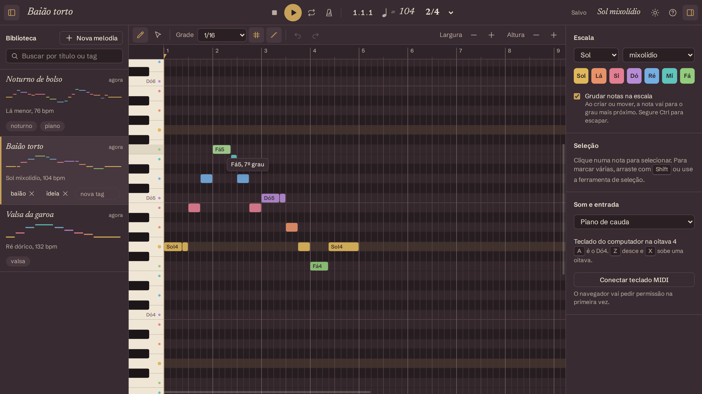
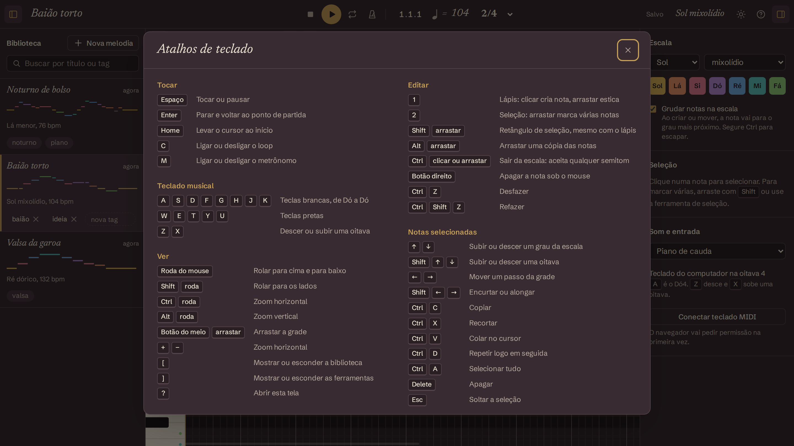

# Melodias

A melody studio that runs in your browser. Sketch a tune on a piano roll, hear it right away, and keep it in a local library. No account and no backend: everything stays on your machine.

[Português](README.pt-BR.md)



## Why it is different

- **Every scale degree has a color.** The tonic is gold, the third is rose, the fifth is blue, and so on. The same colors show up on the notes, on the side keyboard, on the keys that light up during playback and on the library thumbnails, so you can read the shape of a melody at a glance. Notes outside the scale turn gray and hatched.
- **Notes snap to the scale.** Pick a key and a mode; rows outside the scale are dimmed, and creating or dragging notes moves by scale degrees. Hold `Ctrl` to go chromatic.
- **Time is stored in ticks, never in seconds.** Change the tempo or the time signature and nothing breaks.
- **It works offline.** The piano samples and the fonts ship with the app.

## What you can do today

- Piano roll on canvas: click to create a note, drag to stretch it, move, resize, box-select, copy and paste, duplicate, delete, zoom on both axes, smooth scrolling.
- 12 keys and 13 scales and modes (major, minor, the church modes, harmonic and melodic minor, pentatonics, blues, chromatic).
- Quantization grid: 1/4, 1/8, 1/16, 1/32 and triplets.
- Play with the mouse on the side keyboard, with your computer keyboard (`A S D F…`, DAW style) or with a MIDI keyboard through Web MIDI.
- Transport: play, pause, stop, loop region (drag on the ruler), tempo, time signature, metronome, animated playhead.
- Full undo and redo, plus a shortcut sheet on `?`.
- Library in IndexedDB: autosave, search, tags, rename, duplicate, delete.
- Dark and light themes. Three sounds: sampled grand piano, a soft synth and a music box.

The interface is in Brazilian Portuguese for now. Translations are welcome.

| Light theme | Another mode: G Mixolydian |
| --- | --- |
|  |  |



## Run it

You need Node 24 or newer.

```bash
git clone https://github.com/ErickBonruque/melodias.git
cd melodias
npm install
npm run dev
```

Open http://localhost:5173 and click anywhere on the grid. Browsers only allow sound after a first click or key press.

Other commands:

```bash
npm test              # unit tests for the music logic (Vitest)
npm run build         # type check and production build
npm run lint
npm run test:visual   # Playwright walkthroughs (needs the Python setup below)
```

The visual tests use Playwright for Python:

```bash
python3 -m venv .venv
.venv/bin/pip install playwright
.venv/bin/playwright install chromium
```

## How it is built

Vite, React, TypeScript, Zustand and Tailwind for the app; [Tone.js](https://tonejs.github.io/) for audio; [tonal](https://github.com/tonaljs/tonal) for music theory; [Dexie](https://dexie.org/) for the library.

```
src/
  music/   pure music logic: ticks, grid, scales, note operations, transformations (unit tested)
  audio/   the audio engine, the only file that touches Tone.js
  input/   computer keyboard and Web MIDI
  store/   Zustand stores, commands, autosave, and the bridge from state to sound
  ui/      React components and the canvas piano roll (coords, render, controller)
```

The piano roll is a plain controller outside React. It reads the stores, redraws on `requestAnimationFrame` only when something changed, and turns pointer and wheel events into edits. Dragging and scrolling never trigger a React render.

[CLAUDE.md](CLAUDE.md) holds the full architecture notes, the design tokens, the interaction rules and the pitfalls found so far. It was written as context for AI coding agents, and it reads just as well for people. The agent skills used during development are in [.claude/skills](.claude/skills).

## Roadmap

- [x] Phase 1: piano roll, scale snapping, keyboards, transport, undo, library
- [ ] Phase 2: record what you play, hum to create (pitch detection), transformations (transpose, invert, retrograde, humanize), idea generator, chord accompaniment, key detection, sheet music view
- [ ] Phase 3: MIDI, WAV and JSON export, MIDI import, share by link, version history, effects, PWA

## Make it yours

The code is MIT licensed: use it, change it, ship it. Issues and pull requests are welcome, and so are forks that take it somewhere else entirely.

Third-party material keeps its own license:

- Piano samples: Salamander Grand Piano by Alexander Holm, [CC BY 3.0](https://creativecommons.org/licenses/by/3.0/). See [public/samples/piano/LICENCA.md](public/samples/piano/LICENCA.md).
- Agent skills in `.claude/skills`: Anthropic, Apache 2.0.
- Fonts: Newsreader and Schibsted Grotesk, SIL Open Font License, installed from npm.

UX references studied along the way: [signal](https://github.com/ryohey/signal) and [BeepBox](https://github.com/johnnesky/beepbox).
